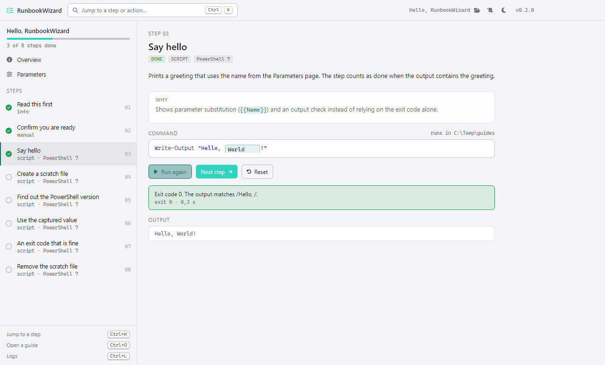

# RunbookWizard

A step-by-step wizard for procedures (setup, install, configuration). It shows each step with its explanation,
shows the exact command, runs script steps with one click and tells you what happened and why.

The core idea is **one unified format for guides** that a person can hand-write and an AI can generate:
Markdown with YAML frontmatter (`*.runbook.md`) or JSON (`*.runbook.json`), validated against one JSON Schema.
RunbookWizard is the reference player for it.

<p align="center">
  <picture>
    <source media="(prefers-color-scheme: dark)" srcset="docs/images/screenshot-dark.png">
    
  </picture>
</p>

- Format specification: [docs/FORMAT.md](docs/FORMAT.md), schema: [schema/runbook.schema.json](schema/runbook.schema.json)
- Examples: [docs/examples](docs/examples)
- Architecture: [docs/ARCHITECTURE.md](docs/ARCHITECTURE.md), decisions: [docs/decisions](docs/decisions)
- Changes: [CHANGELOG.md](CHANGELOG.md)

Guide content is untrusted input: nothing runs without a click and the exact command is always shown first.

## Build and test

```
dotnet build RunbookWizard.slnx
dotnet test RunbookWizard.slnx
dotnet run --project src/RunbookWizard.App -- docs/examples/hello-world.runbook.md
```

`RunbookWizard --health` prints the health JSON (`status`, `version`, `name`); `RunbookWizard <guide>` opens a guide.
UI verification uses the shared automation channel, see [CLAUDE.md](CLAUDE.md).

## License

Licensed under the [Apache License 2.0](LICENSE).
